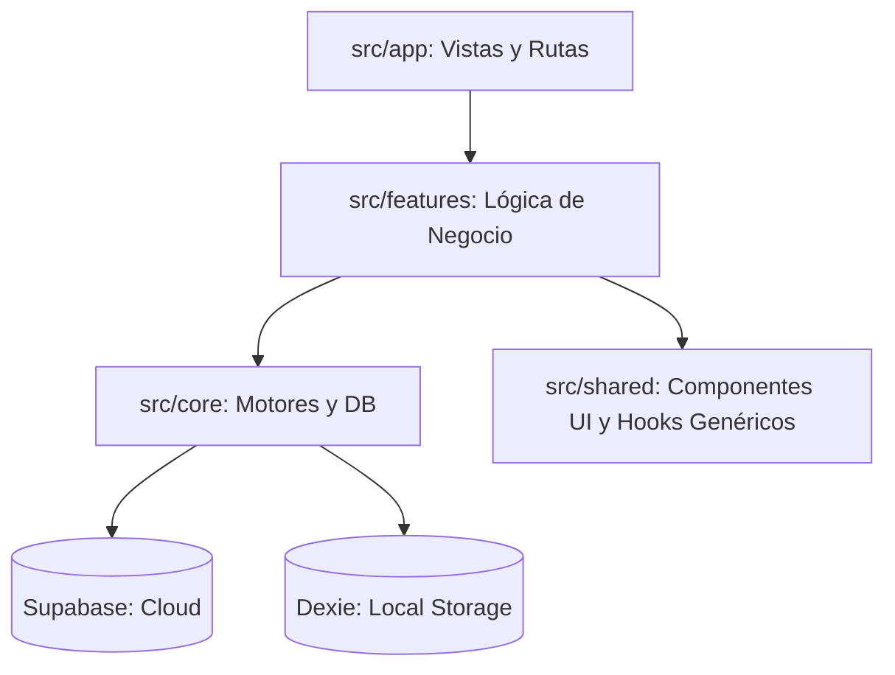
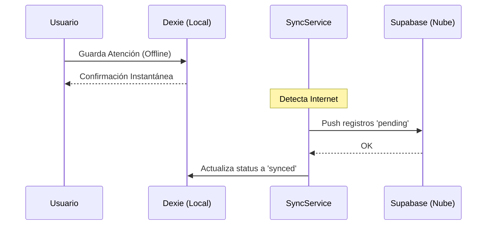

# 🏥 Manual Técnico: Sistema de Tópico Institucional (PWA)

Esta documentación está diseñada para ser la **Fuente de Verdad** del proyecto en Notion. Representa una arquitectura moderna, segura y orientada a la resiliencia de datos.

---

## 📑 1. Arquitectura de Alto Nivel
El sistema sigue un patrón de **Arquitectura Limpia (Clean Architecture)** adaptada para Next.js, separando las responsabilidades en capas claras:

### 📐 Mapa de Dependencias

| Carpeta | Responsabilidad Principal |
| :--- | :--- |
| **`app/`** | **Frontend (Next.js):** Manejo de rutas, layouts y renderizado. |
| **`core/`** | **Infraestructura:** Conectores de base de datos, servicios de sincronización yAuth. |
| **`features/`** | **Dominios:** Lógica encapsulada por módulo (Pacientes, Inventario, Atenciones). |
| **`shared/`** | **Utilitarios:** Lógica y componentes que se repiten en toda la app (CRUD genérico, UI). |

---

## 🔄 2. Estrategia Offline-First (Sincronización)
El corazón del proyecto es su capacidad de funcionar sin internet. No es solo una web app, es una base de datos distribuida.

### Flujo de Datos
1.  **Escritura Local:** Todo cambio se guarda en **Dexie (IndexedDB)** de forma inmediata.
2.  **Estado de Sincronización:** Cada registro tiene un campo `sync_status`. 
    *   `pending`: Solo existe en el navegador.
    *   `synced`: Ya está seguro en Supabase.
3.  **Proceso de Sync:** Al detectar conexión (`navigator.onLine`), el [SyncService](file:///c:/MisProyectosWeb/topico-pwa/src/core/services/syncService.ts#28-159) ejecuta un ciclo de **Push & Pull**.

---

## 🔐 3. Multi-tenancy (Regla de Oro)
Para permitir que un solo despliegue sirva a múltiples colegios de forma segura, implementamos **Aislamiento de Datos por ID (`business_id`)**.

1.  **Filtrado en el Hook:** El hook [useDexieCrud](file:///c:/MisProyectosWeb/topico-pwa/src/shared/hooks/use-dexie-crud.ts#16-113) inyecta automáticamente el `business_id` del usuario en cada consulta.
2.  **RLS (Row Level Security):** En Supabase, las políticas de seguridad impiden que un usuario de un colegio vea datos de otro, incluso si conoce el ID.

---

## 📦 4. Módulos del Sistema (Features)

### 🩺 A. Módulo de Atenciones
Es el módulo más crítico. Realiza operaciones **Atómicas (Transactions)**.
*   **Lógica:** Al crear una atención, se dispara un trigger que genera un movimiento de stock.
*   **Offline:** Si creas 10 atenciones sin internet, se encolan y se procesan en orden exacto al reconectar.

### 💊 B. Módulo de Inventario (Kardex)
*   **Cálculo Dinámico:** El stock no es un campo estático que se edita. Es la **suma de entradas menos la suma de salidas**. Esto evita errores de inventario y descuadres.
*   **Estatus Crítico:** Alertas visuales automáticas cuando el stock baja del `stock_minimo`.

### 👥 C. Módulo de Pacientes
*   **Flexibilidad (JSONB):** Los datos específicos (ej: Aula o Turno) se guardan en el campo `metadata`, permitiendo que el sistema sea usado en institutos, colegios o empresas sin cambiar el código.

---

## 💡 5. Consideraciones de Desarrollo
### Manejo de Estados con `useLiveQuery`
Usamos el hook especializado de Dexie para que la interfaz sea **reactiva**. Si los datos cambian en la base de datos (por ejemplo, llega un dato nuevo desde la nube), la pantalla se actualiza sola sin que el usuario tenga que refrescar.

### Despliegue Sugerido
*   **Vercel:** Para el frontend (CI/CD automático).
*   **Supabase Pro:** $25/mes cuando se superen los 500MB (aprox. 5 años de datos para un colegio mediano).
*   **VPS:** Recomendado solo si se requiere control absoluto del servidor por políticas institucionales ($6/mes).

---

### 📝 Notas Finales para Notion:
> "Este sistema está construido para la resiliencia. La pérdida de conexión no es un error, es un escenario esperado y manejado nativamente."
